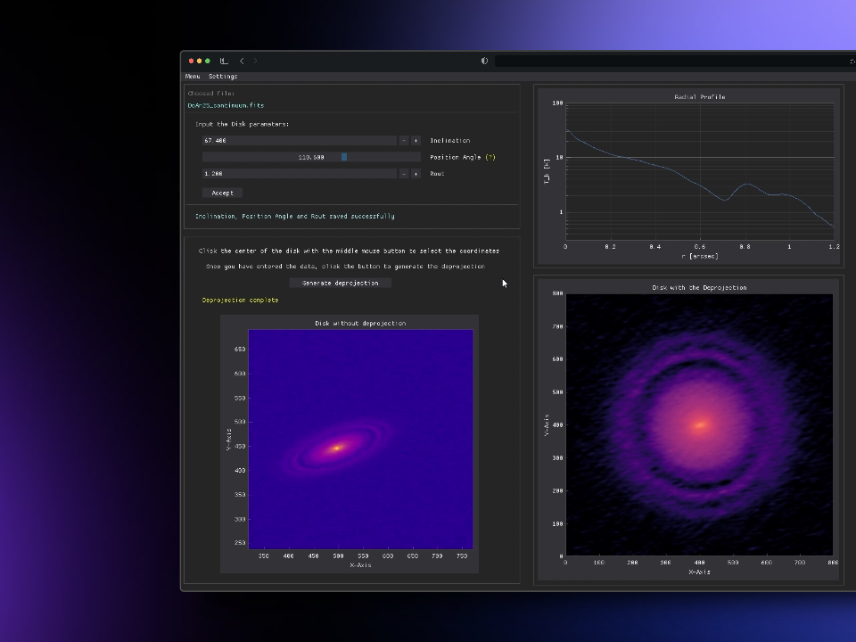

PyPlanet is an open-source project for deprojecting protoplanetary disks, developed as part of the Software Development course (2024) by Amanda Achterberg, Catalina González and Jorge Luis Guzmán.

# Attention: Deprecated.
This project has been superseded by [DISCO Astronomy], its successor and continuation.

# Help
For support and questions, please contact with us in [Contact].

# Screenshot

[DISCO Astronomy]: https://github.com/astrojorgeluis/disco-astronomy
